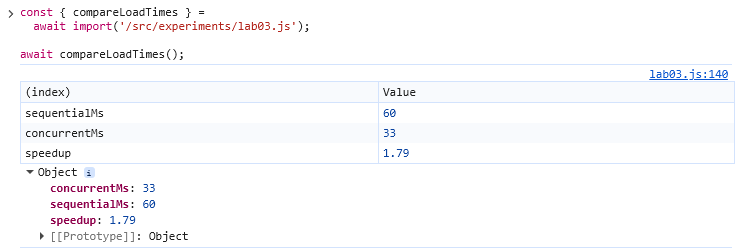
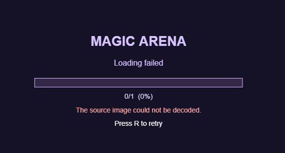

# Magic Arena — лабораторна робота №3

**Тема:** Асинхронний JavaScript: Promises, `async/await` та екран завантаження  
**Проєкт:** Magic Arena — браузерна 2D-гра з керуванням зачарованим літаючим мечем  
**Стек:** JavaScript (ES-модулі), Vite, Canvas 2D, Fetch API, Web Audio API, EventTarget  
**Методичка:** [Лабораторна робота №3](https://github.com/rmalkevy/Programming-Practice-Projects/blob/main/courses/javascript/lab-03-async-javascript.md)

## Мета роботи

Освоїти асинхронну модель JavaScript: `Promise`, `async/await`, порядок задач і мікрозадач, `Promise.all()`, `fetch()` та `AbortController`. Розробити завантажувач зображень, аудіо та JSON із відображенням прогресу, додати спрайтовий рендер і звукові ефекти, забезпечити обмін подіями між модулями й реалізувати лобі з HTTP-отриманням списку кімнат.

## Опис гри й керування

**Magic Arena** — локальна арена з видом зверху. Гравець керує літаючим мечем, стріляє магічними снарядами, ухиляється від рунічних каменів і підбирає кристал лікування. Основні механіки руху, фізики, колізій і здоров’я розроблено у попередніх лабораторних. **Лабораторна №3** додає асинхронне завантаження ресурсів, спрайти, звук і лобі. Реального мережевого мультиплеєра поки немає.

| Клавіша / дія | Призначення |
|---|---|
| `W` / `↑` | Прискорення меча |
| `S` / `↓` | Гальмування |
| `A` / `←`, `D` / `→` | Поворот |
| `Space` | Звичайний магічний постріл |
| `H` | Самонавідний магічний постріл |
| `Join` у лобі | Вибір кімнати, активація Web Audio, запуск гри |
| `R` на екрані помилки | Повторне завантаження після збою |
| `A` **лише під час Loading** | Скасування поточного завантаження |

## Запуск

Потрібні Node.js і npm (рекомендовану версію Node.js зазначено в `.nvmrc`).

```bash
npm install
npm run dev
```

Відкрити адресу, яку показує Vite (зазвичай `http://localhost:5173`). Очікуваний сценарій: **Loading → Lobby → Join → Game**. Для перевірки коду:

```bash
npm run lint
npm run build
```

## Структура основних модулів

```text
public/
├── assets/
│   ├── manifest.json              # перелік ресурсів
│   ├── arena.json                 # конфігурація арени
│   ├── sprites/                   # спрайтшити меча, снаряда, каменя
│   └── audio/                     # shoot, hit, explosion
└── api/
    ├── rooms                      # статичний JSON для GET /api/rooms
    └── rooms.json                 # резервна адреса
src/
├── assets/
│   ├── loader.js                  # fetchJson, loadJson, loadImage, loadAudio, loadAll, withRetry
│   └── boot.js                    # Loading, Abort, Retry, запуск після завантаження
├── audio/audio.js                 # Web Audio і підписка на події
├── lobby/
│   ├── Lobby.js                   # HTTP-запити, таймаут, оновлення кімнат
│   ├── view.js                    # DOM-інтерфейс лобі
│   └── lobby.css
├── render/
│   ├── loading.js                 # прогрес-бар на Canvas
│   └── sprites.js                 # рендер спрайтшитів
├── sim/world.js                   # World як EventTarget
├── sim/collision.js               # ігрові події при зіткненнях
└── main.js                        # інтеграція Loading → Lobby → Game
```

## M1 — асинхронний пайплайн ресурсів

`manifest.json` містить список ресурсів: **3 спрайтшити, 3 аудіофайли та 1 JSON-конфігурацію**. Завантажувач підтримує:

- `fetchJson(url, { signal })`: перевірка `response.ok` і розбір JSON. HTTP 4xx/5xx перетворюються на помилки.
- `loadImage`, `loadAudio`, `loadJson`: асинхронне завантаження з прийманням `AbortSignal`; зображення декодуються через `createImageBitmap`, аудіо — через `decodeAudioData`.
- `loadAll`: запуск завантажень через **`Promise.all()`** і повідомлення про прогрес за кількістю завершених файлів.
- `withRetry`: до трьох спроб для тимчасових збоїв; **exponential backoff + jitter**. HTTP 4xx, abort, timeout і помилка синтаксису JSON не повторюються автоматично.
- `bootGame`: відображення прогрес-бару на Canvas; виклик `start(assets)` тільки після `await loadAll(...)`. У режимі розробки екран результату завантаження додатково утримується на 1,5 секунди для демонстрації.

Функції повертають `Promise` та не блокують основний потік браузера в очікуванні ресурсів. Якщо завантаження не вдалось, показується повідомлення й можливість повтору клавішею `R`.

## M2 — спрайти, Web Audio та шина подій

`drawSheetSprite()` відображає кадри зі спрайтшитів (по 64 × 64 пікселі); персонаж, снаряди й камені використовують завантажені зображення. Для сумісності залишено резервне малювання Canvas за відсутності спрайта. Частинки вибуху та кристал лікування малюються програмно.

У `src/audio/audio.js` створено модуль Web Audio: `AudioBufferSourceNode` передає звук через `GainNode` до `AudioContext.destination`. Звуки **shoot**, **hit** і **explosion** завантажуються й декодуються під час Loading, а `AudioContext.resume()` викликається після натискання гравцем `Join` — це відповідає обмеженням браузерного автозапуску аудіо.

`World extends EventTarget` публікує `CustomEvent`: **`fired`**, **`hit`**, **`exploded`** (також `healed`, `scoreChanged`). Аудіомодуль підписується на перші три події. Завдяки цьому фізика й колізії **не імпортують** аудіомодуль або HUD і не залежать від способу відтворення звуку.

## M3 — лобі та асинхронний список кімнат

Перед грою відкривається лобі, у якому гравець вводить ім'я та вибирає кімнату. `Lobby extends EventTarget` отримує кімнати через **GET `/api/rooms`** (на поточному етапі це статичний JSON, який роздає Vite). Є дві демонстраційні кімнати — **Arcane Ruins** і **Training Grounds**.

Список оновлюється кожні **5 секунд**, кожен запит обмежений таймаутом **3 секунди** (`AbortSignal.timeout`). Попередній запит скасовується перед новим, а при закритті лобі викликається `abort()` і припиняється інтервал. `view.js` створює DOM-елементи й реагує на події `roomsChanged`, `error`, `joined`. Після `Join` гра запускається локально з обраними параметрами кімнати; кількість перешкод може відрізнятися.

## M4 — дослідження асинхронного виконання

### 1. Послідовне й паралельне завантаження

Для порівняння послідовного `await` і паралельного `Promise.all()` використано тимчасовий допоміжний скрипт із вимірюванням через `performance.now()`. Після експерименту його вилучено з основного проєкту, оскільки він не потрібен для запуску гри.

**Фактичний результат вимірювання:**

| Спосіб | Час |
|---|---:|
| Послідовний `await` | **60 мс** |
| Паралельний `Promise.all()` | **33 мс** |
| Прискорення, виведене програмою | **1,79×** |

Паралельний запуск у цьому тесті заощадив **27 мс** (приблизно **45%** часу). Значення коефіцієнта `1,79×` обчислене програмою з точніших внутрішніх вимірювань до округлення мілісекунд. Час залежить від мережі, кешування, планування задач і декодування. Один вимір не означає гарантоване прискорення кожного запуску.



### 2. П'ять головоломок порядку задач і мікрозадач

Для дослідження порядку виконання підготовлено п'ять незалежних прикладів JavaScript. Їх можна запускати безпосередньо в консолі браузера; очікуваний порядок і пояснення наведено нижче. Допоміжний модуль експериментів використовувався лише під час розробки та не входить до фінальної структури гри.

**Головоломка 1 — `async` та `await`**

```js
console.log('A: sword');
const spell = async () => {
  console.log('B: cast');
  await 0;
  console.log('C: resolved');
};
void spell();
Promise.resolve().then(() => console.log('D: callback'));
console.log('E: frame');
```

**Порядок:** `A → B → E → C → D`. Виклик асинхронної функції починається синхронно; її продовження після `await` і callback `.then` виконуються мікрозадачами після завершення синхронного коду.

**Головоломка 2 — `setTimeout` усередині `.then()`**

```js
console.log('A: begin');
Promise.resolve().then(() => {
  console.log('B: then');
  setTimeout(() => console.log('D: timer'), 0);
  Promise.resolve().then(() => console.log('C: nested microtask'));
});
console.log('E: end');
```

**Порядок:** `A → E → B → C → D`. Таймер ставиться в чергу задач уже всередині мікрозадачі; вкладена мікрозадача виконується раніше за таймер.

**Головоломка 3 — `requestAnimationFrame`**

```js
console.log('A: before frame');
requestAnimationFrame(() => {
  console.log('C: animation frame');
  Promise.resolve().then(() => console.log('D: microtask'));
  setTimeout(() => console.log('E: timer after frame'), 0);
});
console.log('B: after scheduling');
```

**Порядок:** `A → B → C → D → E` **за умови, що кадр відбувся**. `requestAnimationFrame` запускається перед відображенням кадру, далі виконується мікрозадача, створена в callback, і після цього таймер.

**Головоломка 4 — `queueMicrotask` і вкладений `.then()`**

```js
console.log('1: start');
queueMicrotask(() => {
  console.log('3: first microtask');
  Promise.resolve().then(() => console.log('5: nested then'));
});
Promise.resolve().then(() => console.log('4: second microtask'));
console.log('2: synchronous');
```

**Порядок:** `1 → 2 → 3 → 4 → 5`. Вкладений `.then()` додається в кінець черги мікрозадач, а не виконується перед уже запланованими.

**Головоломка 5 — два обробники одного Promise**

```js
console.log('start');
const promise = Promise.resolve().then(() => {
  console.log('then 1');
  return 'spell';
});
const waitForSpell = async () => {
  await promise;
  console.log('await');
};
void waitForSpell();
promise.then(() => console.log('then 2'));
console.log('end');
```

**Порядок:** `start → end → then 1 → await → then 2`. Після виконання початкового `.then` очікувач `await` і другий обробник запускаються в порядку реєстрації реакцій на Promise.

### 3. Галерея збоїв завантаження

Завдання галереї — продемонструвати контрольовану обробку некоректних або перерваних завантажень. Докази не слід плутати з припущеннями: нижче окремо вказано **що фактично спостерігали**, а що поки лише передбачено кодом.

| Сценарій | Спосіб відтворення | Спостереження / статус |
|---|---|---|
| **Відсутній/невалідний спрайт** | Тимчасово вказати неправильний URL зображення в `manifest.json` | **Підтверджено скриншотом:** `Loading failed`, `The source image could not be decoded`, пропозиція `Press R to retry`. Це помилка декодування; сам скриншот **не підтверджує HTTP 404**, оскільки Vite може повернути HTML-сторінку за неіснуючою адресою. Статус 404 перевіряється в Network. |
| **Таймаут** | У dev-режимі відкрити `/?lab03=timeout` | **Не підтверджено окремим тестом:** у `boot.js` встановлюється дуже короткий таймаут; очікується екран помилки та можливість Retry після усунення причини. |
| **Abort посеред завантаження** | DevTools → Network → Slow 3G, Disable cache; під час Loading натиснути `A` | **Не підтверджено окремим тестом:** запит скасовується через `AbortController`, очікується контрольоване повідомлення й Retry. |
| **Некоректний JSON** | Тимчасово зіпсувати синтаксис `public/assets/arena.json` | **Не підтверджено окремим тестом:** `response.json()` має відхилитися з `SyntaxError`; очікується екран помилки й Retry після виправлення JSON. |

**Отриманий скриншот помилки завантаження зображення:**



**Порядок відновлення:** виправити URL/JSON або прибрати тестовий параметр у URL, а потім натиснути `R`. При помилці завантаження не запускається симуляція гри; замість цього показується повідомлення з можливістю повтору. Наявність цієї можливості підтверджена скриншотом, але успішний результат Retry для кожного випадку окремо не документовано.

### 4. Використані асинхронні механізми

- **`Promise`** має стани `pending`, `fulfilled`, `rejected`; у разі відхилення помилка переходить до `catch` / `try...catch`.
- **`async/await`** спрощує запис асинхронних операцій без блокування основного потоку на час мережевого очікування.
- **`Promise.all`** очікує всі ресурси й відхиляється, якщо не завантажився бодай один. Інші запущені завдання від цього не скасовуються автоматично.
- **`AbortController` і `AbortSignal.timeout`** скасовують запити; **`AbortSignal.any`** об'єднує ручне скасування й таймаут.
- **`EventTarget` та `CustomEvent`** роз'єднують ігрову логіку, звук і лобі.
- **Web Audio** декодує буфери при завантаженні та відтворює звуки після жесту гравця.

## Підсумок лабораторної №3

У лабораторній роботі №3 розширено гру **Magic Arena** шляхом створення асинхронного пайплайна ресурсів. Реалізовано завантаження спрайтшитів, звуків і JSON через `fetch` та `async/await`, паралельне виконання `Promise.all`, повторні спроби з exponential backoff і jitter, скасування через `AbortController`, а також екран завантаження з прогрес-баром і повідомленням про помилки. Додано відображення об'єктів зі спрайтшитів, звукові ефекти Web Audio та подієву взаємодію `EventTarget`/`CustomEvent`. Створено лобі з введенням імені, вибором кімнати, автоматичним оновленням даних і таймаутом запитів. Підготовлено п'ять експериментів із чергами задач та мікрозадач; у фактичному вимірюванні паралельне завантаження було швидшим за послідовне (33 мс проти 60 мс). Зафіксовано контрольовану реакцію на помилку декодування зображення. Результати решти трьох сценаріїв збоїв потребують окремої практичної перевірки перед твердженням про їх успішне проходження.