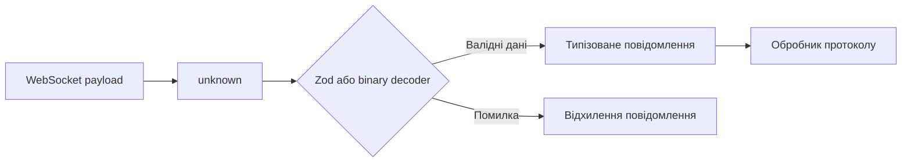

# Magic Arena — лабораторна робота №6

**Тема:** TypeScript для протоколу, симуляції, клієнта та сервера  
**Проєкт:** Magic Arena — браузерна багатокористувацька 2D-гра із зачарованим літаючим мечем  
**Технології:** TypeScript (ESM), Node.js 24, npm workspaces, Vite, Canvas 2D, WebSocket (`ws`), Zod, ESLint, GitHub Actions  

## Мета та результат

Мета роботи — перевести три пакети Magic Arena на TypeScript зі строгими перевірками типів, створити спільний типізований протокол і забезпечити runtime-валідацію даних на межах системи. Міграція не передбачає додавання нових ігрових механік.

Збережено авторитетну серверну симуляцію 30 Hz, client-side prediction, reconciliation, інтерполяцію віддалених сутностей, локальне передбачення снарядів та обмін повідомленнями у форматах JSON і Binary. Типи під час виконання стираються, тому зовнішні дані додатково перевіряються через Zod або бінарний декодер.

## Запуск

Потрібні Node.js 24 (середовище розробки — 24.19.0) та npm. Команди виконуються з кореня репозиторію.

```powershell
npm ci
if (!(Test-Path server/.env)) { Copy-Item server/.env.example server/.env }
```

У першому терміналі:

```bash
npm run dev:server
```

У другому терміналі:

```bash
npm run dev:client
```

Відкрити `http://localhost:5173`. Для багатокористувацької демонстрації відкрити два вікна, ввести різні імена та зайти в одну кімнату. Vite проксує `/api` і `/ws` на сервер.

Запуск зі зібраним клієнтом:

```bash
npm run build
node --env-file=server/.env server/src/index.ts
```

Гра доступна за адресою `http://127.0.0.1:3000` при стандартних локальних налаштуваннях.

### Керування

| Клавіша | Дія |
|---|---|
| W | Прискорення меча |
| S | Гальмування |
| A / D | Обертання |
| Space | Звичайний постріл |
| H | Постріл із коригуванням траєкторії біля каменя |

### Конфігурація мережі

Приклад `server/.env` для демонстрації зі штучною затримкою:

```dotenv
HOST=127.0.0.1
PORT=3000
LOG_DIR=server/logs
NET_CODEC=binary
NET_DELAY_MS=100
NET_JITTER_MS=30
NET_DROP_RATE=0.02
```

`NET_CODEC` визначає формат input та snapshot (`json` або `binary`). Для тестування без штучної затримки встановити `NET_DELAY_MS`, `NET_JITTER_MS` і `NET_DROP_RATE` у `0`. Після зміни конфігурації перезапустити сервер. Змінні оточення проходять перевірку Zod; локальний `.env` не потрібно додавати до Git.

## Структура проєкту

Основні модулі та конфігурації:

```text
MagicArena/
├── client/
│   ├── src/
│   │   ├── main.ts
│   │   ├── assets/
│   │   ├── audio/
│   │   ├── lobby/
│   │   ├── render/
│   │   └── network/
│   │       ├── connection.ts
│   │       ├── prediction.ts
│   │       ├── interpolation.ts
│   │       ├── projectiles.ts
│   │       └── netgraph.ts
│   └── tsconfig.json
├── server/
│   ├── src/
│   │   ├── index.ts
│   │   ├── config.ts
│   │   ├── rooms.ts
│   │   ├── protocol.ts
│   │   ├── ws.ts
│   │   ├── game/
│   │   ├── network/
│   │   └── log/
│   ├── test/
│   ├── scripts/
│   └── tsconfig.json
├── shared/
│   ├── src/
│   │   ├── index.ts
│   │   ├── types.ts
│   │   ├── sim/
│   │   ├── entities/
│   │   ├── protocol/
│   │   └── codec/
│   ├── test/
│   ├── type-tests/
│   └── tsconfig.json
├── scripts/audit-types.mjs
├── .github/workflows/
├── tsconfig.base.json
├── tsconfig.json
└── docs/
    ├── lab04/
    └── lab05/
```

## Виконання M1–M4

### M1 — TypeScript toolchain та спільна симуляція

Налаштовано кореневий `tsconfig` і конфігурації окремих workspace. Основні параметри:

| Параметр | Призначення |
|---|---|
| `strict` | Строгі перевірки, зокрема `null`, `undefined` і неявного `any` |
| `noUncheckedIndexedAccess` | Врахування можливого `undefined` при індексації |
| `verbatimModuleSyntax` | Явне розмежування runtime-імпортів та `import type` |
| `useUnknownInCatchVariables` | Безпечна типізація перехоплених помилок |
| `erasableSyntaxOnly` | Використання синтаксису, придатного для native type stripping |
| `noEmit` | Перевірка типів без створення JavaScript-файлів |

Модулі `shared` переведено на TypeScript. `Vector2` має `readonly`-координати. Сутності та snapshot описуються об'єднанням типів із полем `kind`, а `EntityId`, `Tick` і `Seq` є branded-типами. Типізовано `World`, фізику, поведінки, зіткнення та сценарій детермінізму. Спільна симуляція не залежить від браузерного інтерфейсу або Node.js API.

Vite транспілює TypeScript клієнта, а Node.js 24 запускає сервер через native type stripping. Перевірка типів виконується окремо командою `npm run typecheck`.

### M2 — Типізований протокол і runtime-валідація

Схеми Zod описують структуру клієнтських і серверних повідомлень. TypeScript-типи мережевих повідомлень виводяться через `z.infer`, тому не потрібно підтримувати окремий ручний опис протоколу. `parseClientMessage` приймає `unknown` і повертає результат перевірки замість неперехопленого винятку при некоректних даних. Сервер обробляє помилкові пакети, записує повідомлення в лог і закриває з'єднання з відповідним кодом.



JSON і Binary мають спільний generic-інтерфейс `Codec`. Формат і версію бінарного протоколу з ЛР №5 збережено. Декодер перевіряє заголовок, версію, межі буфера, числові діапазони, прапорці та зайві байти. Тести підтверджують, що input із `fireSeq` займає 23 байти, а порожній snapshot — 16 байтів.

Вичерпні `switch` із `never` використовуються для обробки типізованих повідомлень і видів сутностей. Невідомі числові значення в бінарному пакеті відхиляються під час виконання.

### M3 — Сервер, клієнт та CI

Серверні й клієнтські модулі мігровано на TypeScript. Для серверних подій кімнат використовується типізований `EventEmitter`, а на клієнті — generic-механізм подій. Зв'язок між назвою події та її payload перевіряється компілятором. Конфігурація з `process.env` проходить Zod-валідацію з типовими значеннями та допустимими діапазонами.

Дані з мережі та JSON спочатку розглядаються як `unknown`, після чого перевіряються або звужуються до потрібного типу. Збережено роботу Canvas, циклу `requestAnimationFrame`, лобі, чату, netgraph та мережевої синхронізації.

Додано compile-time тести для branded-типів, `readonly` і вичерпності union. Налаштовано ESLint для TypeScript та скрипт `audit:types`, який аналізує AST production-файлів. GitHub Actions налаштовано для встановлення залежностей і запуску перевірки типів при push та pull request.

### M4 — Рішення щодо UI-фреймворку

React, Vue та Svelte не використовувалися. Лобі й HUD уже реалізовані через DOM та Canvas, тому для цієї роботи достатньо типізувати існуючі компоненти та їхні події. Переписування інтерфейсу додало б нові залежності та складність збірки без необхідної для лабораторної функціональної вигоди. Canvas і цикл гри залишено незалежними від UI-фреймворку. Окреме вимірювання впливу фреймворків на bundle не проводилося.

## What TypeScript found

Під час запуску `npm run typecheck` були виявлені такі реальні проблеми:

| Файл | Проблема | Виправлення |
|---|---|---|
| `client/src/assets/boot.ts` | TS2339: у кореневій конфігурації не розпізнавався `import.meta.env`. | Додано `client/src/vite-env.d.ts` із посиланням на `vite/client`. |
| `shared/src/codec/binary.ts` | TS2564, TS2565: компілятор не гарантував ініціалізацію `Reader.buffer` перед використанням. | У гілці некоректних даних використано явний `throw`, щоб усі нормальні шляхи конструктора ініціалізували буфер. |
| `shared/src/codec/json.ts` | TS2345: несумісні типи `ArrayBufferView` при виклику `TextDecoder.decode` у серверній конфігурації. | Для представлення буфера створено `Uint8Array` із його `byteOffset` і `byteLength`; збережено правильні межі даних. |

Перші дві проблеми спричинили сім повідомлень компілятора. Після їх виправлення серверна перевірка виявила ще одну несумісність типів. Після виправлення кодека коренева перевірка та перевірки всіх workspace пройшли успішно.

Окремо runtime-тест `Room enforces player limit` спочатку завершувався помилкою `autoPong` у конструкторі WebSocket. Проблему тестового створення сокета виправлено, після чого користувацька перевірка завершилася успішно. Це проблема виконання тесту, а не помилка, знайдена статичною типізацією.

## Three interesting types

### 1. Branded types — EntityId, Tick, Seq

Звичайні псевдоніми `type Tick = number` і `type Seq = number` були б взаємозамінними. Branded-типи додають до типу умовну мітку: числове значення залишається числом у runtime, але компілятор розрізняє його призначення. У проєкті для цього використовуються Zod-бренди та конструктори `toEntityId`, `toTick`, `toSeq`.

Скорочений приклад застосування:

```ts
const seq = toSeq(42);
const tick = toTick(100);
const id = toEntityId(1);
```

Функція, що очікує `Seq`, не повинна приймати `Tick` або `EntityId`. Це запобігає випадковому змішуванню номера команди, номера кроку та ідентифікатора сутності. Compile-time тести фіксують ці обмеження.

### 2. Discriminated union — ClientMessage та EntitySnapshot

Об'єднання типів містить кілька можливих структур зі спільним полем-ознакою. Для мережевих повідомлень це `type`, а для сутностей — `kind`. Наприклад, після перевірки `message.type === 'input'` TypeScript дозволяє працювати з `seq` і `turn`, а після перевірки `entity.kind === 'sword'` — зі специфічними полями меча.

Скорочений приклад принципу вичерпної обробки:

```ts
switch (message.type) {
  case 'join':  return handleJoin(message);
  case 'input': return handleInput(message);
  case 'chat':  return handleChat(message);
  case 'ping':  return handlePing(message);
  default: {
    const exhaustive: never = message;
    throw new Error(`Unhandled message: ${exhaustive}`);
  }
}
```

Тут назви `handle...` умовні: приклад демонструє принцип обробника, а не дослівну копію `ws.ts`. Якщо до union додати нове повідомлення й не додати його обробку, присвоєння до `never` спричинить помилку компіляції.

### 3. Generics — Codec та типізовані події

Generic дає змогу перевикористовувати один інтерфейс для різних типів, не втрачаючи зв'язок між аргументом та результатом. Для кодеків використовується ідея такого інтерфейсу:

```ts
interface Codec<T, TWire = string | ArrayBuffer> {
  readonly name: string;
  encode(message: T): TWire;
  decode(data: unknown): T;
}
```

JSON повертає рядок, Binary — `ArrayBuffer`; обидва після декодування повертають типізоване ігрове повідомлення. На вході `decode` залишається `unknown`, оскільки тип даних із мережі необхідно підтвердити.

Аналогічно в typed event bus параметр `K extends keyof Events` обмежує ім'я події відомими ключами, а `Events[K]` визначає її payload. Обробник не може випадково отримати дані іншого типу події без помилки типізації.

## Перевірки

```bash
npm run typecheck
npm run audit:types
npm run lint
npm test
npm run build
```

### Результати

| Перевірка | Результат |
|---|---|
| Typecheck — root та три workspace | Успішно, 0 помилок |
| TypeScript production-файлів (AST-аудит) | 71 |
| Явний `any` (AST-аудит) | 0 |
| Type assertions | 1 (менше 5) |
| Non-null assertions | 0 |
| ESLint | Успішно |
| Автоматизовані тести | 38 тестів; після виправлення останнього тесту підтверджено успішне проходження перевірок |
| Production build | Підтверджено разом із повторними перевірками |
| Детермінований сценарій (1000 кроків) | Успішно |
| GitHub Actions | Workflow налаштовано; результат запуску перевіряється після push |

Кількість файлів і приведень наведена за отриманим виводом `audit:types` перед виправленням тестового WebSocket. Єдине приведення зафіксовано в `client/src/assets/loader.ts:169`. Воно вкладається в допустимий ліміт; його конкретне призначення та наявність пояснювального коментаря слід перевірити у вихідному коді перед захистом.

Тести охоплюють JSON/Binary round-trip, точні байти пакетів, некоректні версії, прапорці й діапазони, Zod-валідацію, конфігурацію, обмеження кімнат, відновлення сутностей та детермінізм. Compile-time тести додатково перевіряються командою `typecheck`, а не запускаються як звичайні runtime-тести.

### Детермінізм після міграції

Тест із 1000 кроків підтвердив однаковий результат для однакових вхідних параметрів. Для окремого порівняння з фінальною версією ЛР №5 використовується та сама команда:

```powershell
node --input-type=module -e "import {runDeterministicScenario} from '@magicarena/shared'; import {createHash} from 'node:crypto'; const state=runDeterministicScenario({seed:1337,steps:1000,dt:1/30}); const json=JSON.stringify(state,(_,v)=>typeof v==='number'&&!Number.isInteger(v)?Number(v.toFixed(8)):v); console.log(createHash('sha256').update(json).digest('hex'));"
```

Еталонний SHA-256 із ЛР №5 (дробові значення нормалізовано до восьми знаків після коми лише для порівняння):

```text
2c3473173bbe25250e49d567e01a55f7823bf3ea1bdff5a769f64a33362d729f
```

Результат окремого порівняння хешів після міграції ще не зафіксовано. Успішний тест повторюваності сценарію не є сам по собі доказом збігу з історичним хешем.


## Висновок

У лабораторній роботі проєкт Magic Arena переведено на TypeScript зі строгими налаштуваннями перевірки. Використано структурну типізацію, branded-типи, readonly-дані, discriminated unions, generic-інтерфейси та типізовані події. Zod і бінарний декодер забезпечують перевірку зовнішніх даних під час виконання, а TypeScript і CI допомагають виявляти помилки до запуску. Автоматизовані перевірки підтверджують детермінізм сценарію та сумісність бінарного формату з попередньою лабораторною.
