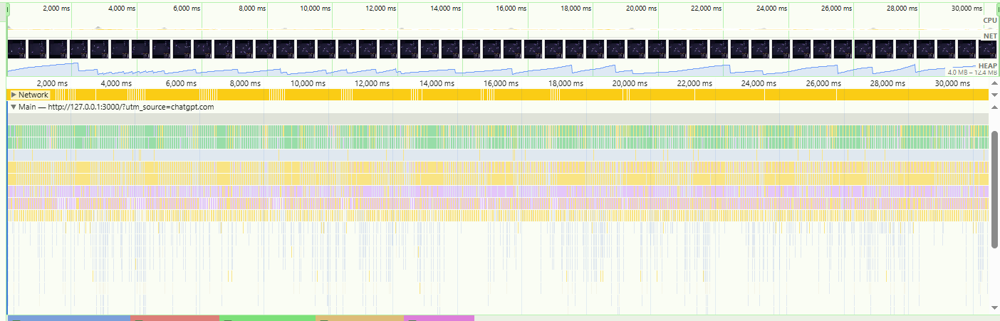
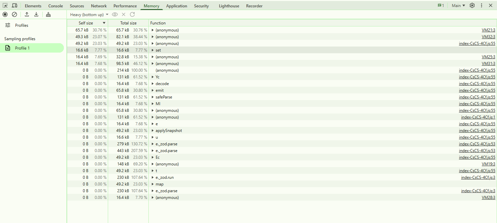
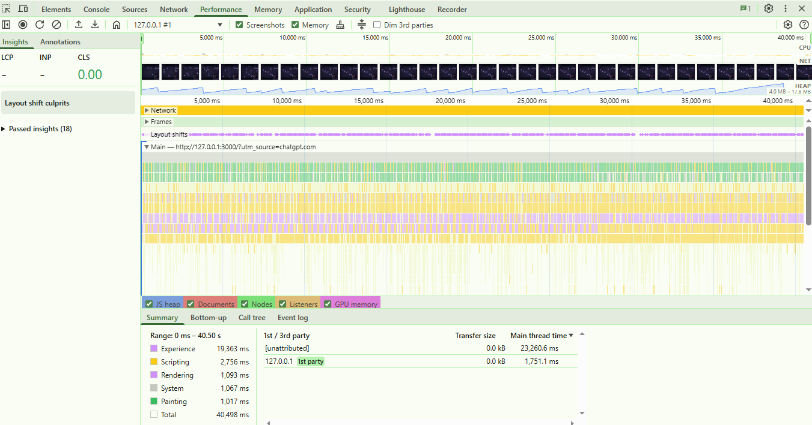
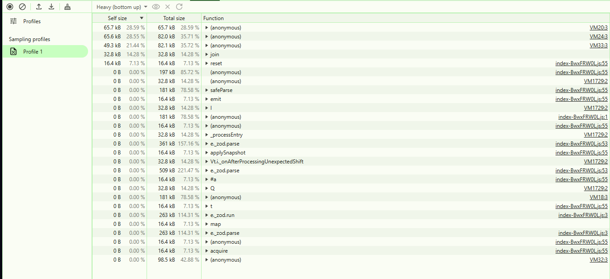
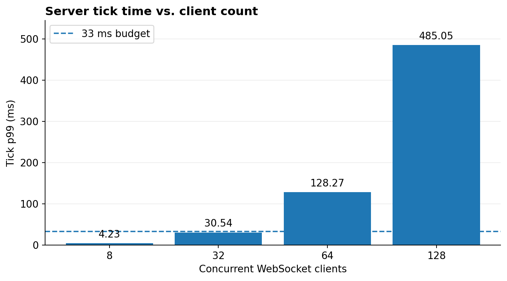
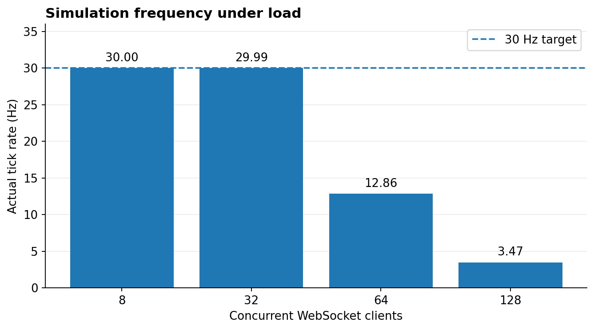
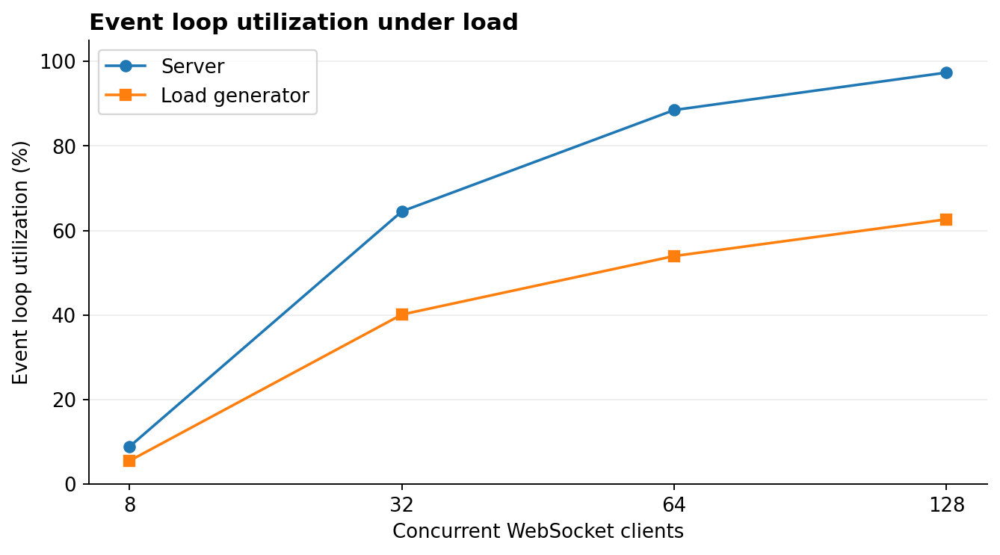

# Magic Arena — лабораторна робота №7

[](https://github.com/Dendelon/MagicArena/actions/workflows/typecheck.yml)

**Тема:** JavaScript engines, пам’ять і тестування: V8, GC, профілювання та продуктивність.  
**Проєкт:** Magic Arena — браузерна багатокористувацька 2D-гра із зачарованим літаючим мечем.  
**Технології:** TypeScript, Node.js 24, Vite, Canvas 2D, WebSocket (`ws`), Zod, Vitest, fast-check, Playwright, ESLint, GitHub Actions.

## Мета та результат

Мета — підтвердити коректність симуляції та мережевого протоколу автоматизованими тестами, дослідити витрати часу й пам’яті, зменшити тиск на GC, оцінити Web Worker та визначити межу продуктивності сервера. Збережено серверну авторитетну симуляцію 30 Hz, prediction, reconciliation, interpolation і бінарний протокол попередніх лабораторних.

Результат: **238 тестів**, **10 property-based тестів**, покриття `shared` понад 85% за всіма метриками. Пул повторно використав понад 99% об’єктів у вимірюванні після оптимізації. Worker не дав виграшу за виміряним часом головного потоку. Найбільше перевірене навантаження в межах бюджету — **32 клієнти**.

## Запуск

Команди виконуються в корені репозиторію. Потрібні Node.js 24 та npm.

```powershell
npm ci
if (!(Test-Path server/.env)) { Copy-Item server/.env.example server/.env }
npx playwright install chromium
```

Перший термінал: `npm run dev:server`. Другий: `npm run dev:client`. Відкрити `http://localhost:5173`. Для демонстрації multiplayer відкрити два вікна, ввести різні імена і зайти в одну кімнату. Vite проксує `/api` та `/ws`.

| Клавіша | Дія |
|---|---|
| W | Прискорення |
| S | Гальмування |
| A / D | Обертання |
| Space | Звичайний постріл |
| H | Самонавідний постріл |

Для production-збірки: `npm run build`, потім `node --env-file=server/.env server/src/index.ts`. Локальна адреса за типової конфігурації — `http://127.0.0.1:3000`.

## Структура

```text
client/                       # Canvas, input, prediction, interpolation
  src/network/                # connection, codec decoder, Worker
  src/performance/            # FrameProfiler, DecodeProfiler
  test/                       # клієнтські тести
server/
  src/bots/                   # Bot, BotClient, BotManager
  src/performance/            # ServerProfiler, LoadProfiler
  scripts/load-test.ts        # запуск навантажувальних сценаріїв
  scripts/load-test/          # допоміжні модулі runner
  test/                       # серверні тести
shared/
  src/codec/                  # JSON / Binary
  src/sim/                    # фізика, ObjectPool, BulletPool, ParticlePool
  test/                       # unit та property-based тести
e2e/                          # Playwright
.github/workflows/typecheck.yml # CI
docs/lab07/                   # вимірювання, скриншоти та графіки
```

## M1 — Автоматизовані тести

Vitest запускається з кореня та охоплює всі три workspaces. Unit-тести перевіряють Vector2, інтегрування меча, зіткнення (дотик, перекриття, промах, tunneling), детермінізм World.step, prediction/reconciliation, object pool, codec, rate limiting. Fake timers використовуються для accumulator loop і heartbeat. Інтеграційні тести перевіряють реальні WebSocket-з’єднання, ботів, профайлери та навантажувальний runner.

`shared/test/properties.test.ts` містить 10 тестів: зокрема round-trip бінарних повідомлень із допуском квантування, довжину пакета, валідні й мутовані повідомлення, контрольовану `BinaryDecodeError` для довільних масивів байтів (якщо випадковий пакет валідний — перевіряється його результат), інваріанти координат і швидкості протягом 1000 послідовних випадкових кроків. fast-check генерує вхідні дані та зменшує контрприклад у разі помилки.

### Фінальний результат тестів (26.11.2026)

- Test Files: **32 passed (32)**.
- Tests: **238 passed (238)**.
- Тривалість локального запуску з coverage: 9,36 с.

| Coverage `shared` | Покрито / всього | Результат | Поріг |
|---|---:|---:|---:|

| Statements | 1036 / 1118 | 92.66% | 85% |

| Branches | 634 / 743 | 85.32% | 85% |

| Functions | 188 / 208 | 90.38% | 85% |

| Lines | 1004 / 1074 | 93.48% | 85% |

Джерело: [фінальний coverage summary](docs/lab07/coverage-summary.json) та локальний звіт Vitest. Покриття стосується спільного пакета, а не всього репозиторію.

```bash
npm test
npm run test:coverage
npm run test:shared
npm run test:server
npm run test:client
```

## M2 — E2E та CI

Playwright запускає сервер через `webServer`, використовує два незалежні browser contexts, перевіряє roster в обох, реальний рух віддаленого меча після натискання W (бюджет першого помітного руху 500 мс) і чат. Окремо тестується реальний Web Worker у браузері. Результат руху береться з render probe, а не лише зі стану отриманого snapshot.

GitHub Actions запускається на push та pull request: `npm ci` → typecheck → audit:types → lint → Vitest/coverage → build → Playwright Chromium. Зберігаються coverage report, Playwright report та артефакти помилок. ESLint використовує type-aware правила, зокрема `@typescript-eslint/no-floating-promises`; небезпечні неявні `any` виправлені.

```bash
npm run typecheck
npm run lint
npm run audit:types
npm run test:coverage
npm run build
npm run test:e2e
npm run test:e2e:worker
```

Усі ці команди пройдено локально за результатами фінальної перевірки. Статус CI для фінального коміту відображається в badge після push; локальний результат не є підтвердженням нового віддаленого запуску.

## M3 — Профілювання та оптимізація

### Методика

Використано Chrome DevTools Performance / Memory, CPU profiling Node.js (`--cpu-prof`), власні профайлери і User Timing (`performance.mark/measure` для simulate, render, decode та reconcile). Вимірювання baseline і after: Performance Arena, один клієнт та 8 ботів, binary codec, арена 960×640, нуль delay/jitter/drop, приблизно 30 секунд. Боти створюють активність і постріли. Для числових вимірювань гравець не керував локальними снарядами. Середовище навантажувального експерименту: Windows 10, Node.js 24.19.0, AMD Ryzen 5 4600H, 12 логічних процесорів, близько 16 ГБ RAM.

**Frame interval** — час між RAF-кадрами; **frame work** — тривалість роботи ігрового callback. Це різні метрики. Tick охоплює також створення snapshot, кодування та broadcast.

### Before / after — клієнт і сервер

| Метрика | Before | After |
|---|---:|---:|

| Frame interval p50, мс | 16.700 | 16.700 |

| Frame interval p95, мс | 16.800 | 16.800 |

| Frame interval p99, мс | 16.800 | 16.800 |

| Frame work p50, мс | 0.500 | 0.600 |

| Frame work p95, мс | 0.700 | 0.800 |

| Frame work p99, мс | 0.900 | 0.900 |

| Simulation p50, мс | 0.100 | 0.100 |

| Simulation p95, мс | 0.200 | 0.300 |

| Simulation p99, мс | 0.300 | 0.300 |

| Render p50, мс | 0.400 | 0.500 |

| Render p95, мс | 0.600 | 0.700 |

| Render p99, мс | 0.700 | 0.700 |

| Server tick p50, мс | 2.161 | 2.516 |

| Server tick p95, мс | 3.428 | 4.073 |

| Server tick p99, мс | 3.898 | 4.613 |

| World step mean, мс | 0.062 | 0.073 |

| World step p99, мс | 0.196 | 0.216 |

| Collision mean, мс | 0.013 | 0.015 |

| Collision p99, мс | 0.108 | 0.150 |

| Snapshot creation mean, мс | 0.346 | 0.442 |

| Snapshot creation p99, мс | 0.735 | 0.965 |

| Binary encoding mean, мс | 1.349 | 1.562 |

| Binary encoding p99, мс | 2.536 | 2.791 |

| Broadcast mean, мс | 2.076 | 2.467 |

| Broadcast p99, мс | 3.721 | 4.394 |

| FPS | 60.032 | 59.997 |
| Кадри понад 33 мс | 0 | 0 |
| Tick понад 33 мс | 0 | 0 |

Після pooling frame work p99 залишився 0,9 мс; frame interval p99 — 16,8 мс. Server tick p99 зріс із 3,898 до 4,613 мс, хоча обидва результати нижчі за бюджет 33 мс. Отже, покращення CPU-часу не доведено. Collision займає незначну частку часу; spatial hash не впроваджувався, оскільки вимірювання не визначили collision як головний bottleneck.

### GC — зіставні перші 30 секунд трас Chrome

| Метрика | Before | After |
|---|---:|---:|

| Minor GC — кількість | 22 | 11 |

| Minor GC — сумарно, мс | 20.474 | 11.853 |

| Minor GC — max, мс | 1.291 | 1.449 |

| Major GC — кількість | 8 | 8 |

| Major GC — сумарно, мс | 18.583 | 19.168 |

| Major GC — max, мс | 6.235 | 4.245 |

| Разом — кількість | 30 | 19 |

| Разом — сумарно, мс | 39.057 | 31.021 |

| Разом — max, мс | 6.235 | 4.245 |

| Server GC events (окремий вимір) | 103 | 125 |
| Server GC total, мс | 51.656 | 65.840 |

Browser GC count: 30 → 19 (−36,7%); сумарний час 39,057 → 31,021 мс (−20,6%). Incremental marking враховано окремо, не додано до комбінованих GC. Major GC залишилося 8 у кожній зіставній ділянці. Ціль нульових Major GC **не досягнута**; p99 RAF-інтервалу 16,8 мс також не менший за 16,7 мс. На дисплеї близько 60 Hz інтервал кадру залежить від refresh rate та таймерів, тоді як робота callback займає менше 1 мс на p99. Залишкові алокації в декодуванні, Zod і snapshot processing створюють тиск на GC; точну причину кожної Major GC не встановлено.

### Flame chart та Memory

**Before:**





**After:**





Топ-3 self allocator nodes у heap sampling (імена мінімізовані або anonymous; ідентифікатори локальні для відповідного профілю):

| Rank | Before | Sampled bytes | After | Sampled bytes |
|---|---|---:|---|---:|

| 1 | `(anonymous)` (script 21, 2:16) | 65676 | `(anonymous)` (script 20, 2:16) | 65676 |

| 2 | `(anonymous)` (script 32, 2:16) | 49264 | `(anonymous)` (script 24, 2:16) | 65604 |

| 3 | `(anonymous)` (script 3, 54:27323) | 49176 | `(anonymous)` (script 33, 2:16) | 49264 |

У збережених allocation stacks присутні `safeParse` / Zod, `applySnapshot`, `map` та операції з пулом. Загальний sampled heap: 213 512 → 229 752 байти. Це вибіркове вимірювання, а не сумарний обсяг алокацій; зменшення загального обсягу алокацій не доведено.

Топ-3 функції браузерного application CPU profile (self sample time, мс):

| Rank | Before | Self, мс | After | Self, мс |
|---|---|---:|---|---:|

| 1 | `Vl` | 392.130 | `tu` | 564.596 |

| 2 | `C` | 354.855 | `T` | 491.477 |

| 3 | `setPendingCount` | 111.775 | `setPendingCount` | 89.063 |

Імена мінімізовані, тому без source maps не можна достовірно ототожнити `Vl` і `tu` або `C` і `T`. Траси мають різну тривалість (30,49 та 40,50 с); self-time суми не є прямим порівнянням швидкості.

### Server CPU profile

| Функція | Before self, с | After self, с | Before мс/с профілю | After мс/с профілю |
|---|---:|---:|---:|---:|

| `transfer` | 9.707 | 8.505 | 18.778 | 22.014 |

| `inst._zod.parse` | 2.870 | 2.488 | 5.552 | 6.439 |

| `transferEntity` | 2.636 | 2.352 | 5.100 | 6.087 |

Профілі Node.js охоплюють життя процесів (516,92 та 386,36 с), а не ізольовані 60-секундні матчі. Вони дозволяють знайти гарячі функції, але не є строго контрольованим порівнянням CPU. Основні гарячі ділянки — binary codec та Zod. Окремі 30-секундні tick measurements наведено вище.

### Реалізовані оптимізації

- `ObjectPool`, `BulletPool`, `ParticlePool`: acquire/release, повторна ініціалізація полів, облік created/reused/active. Окремі пули для world та локальних predicted projectiles.
- Зміна внутрішніх координат і швидкостей in-place там, де це не порушує readonly API; зменшення тимчасових Vector2 у гарячих операціях. Ущільнення масиву активних частинок без створення нового масиву.
- Повна повторна ініціалізація об’єкта перед використанням, щоб не переносити старі ID, TTL, координати або стан. Необґрунтованих змін hidden classes або переходу на SoA/typed arrays не виконано.
- Коректність перевіряється pooling-regression і determinism tests; поведінка симуляції збережена.

| Пул | Acquired | Reused | Created |
|---|---:|---:|---:|

| serverWorld / bullets | 221 | 219 | 2 |

| serverWorld / particles | 945 | 928 | 17 |

| clientWorld / bullets | 4625 | 4623 | 2 |

| clientWorld / particles | 15972 | 15955 | 17 |

Разом: 21 763 acquire, 21 725 reuse, 38 створень (99,83% повторного використання). Локальний пул передбачених снарядів у цьому вимірюванні не був активний. Пул зменшує потребу створювати нові об’єкти саме цих типів, але утримує пам’ять і потребує правильного reset. Одного запису на версію недостатньо, щоб довести загальний виграш CPU.

Дані: [before metrics](docs/lab07/before/metrics.json), [after metrics](docs/lab07/after/metrics.json), [GC before](docs/lab07/before/browser-gc.json), [GC after](docs/lab07/after/browser-gc.json), [повне порівняння](docs/lab07/comparison.json). Raw `.cpuprofile`, `.heapprofile` та `.json.gz` зберігаються локально у `profiles/` і не входять до Git.

### Відтворення профілювання

Зупинити інші сервери, зібрати клієнт і запустити локальний сервер (PowerShell):

```powershell
npm run build:profile
$env:HOST = "127.0.0.1"
$env:PORT = "3000"
$env:ENABLE_BOTS = "1"
$env:ENABLE_PROFILE = "1"
$env:NET_CODEC = "binary"
$env:NET_DELAY_MS = "0"
$env:NET_JITTER_MS = "0"
$env:NET_DROP_RATE = "0"
node server/src/index.ts
```

Для CPU profile замість останньої команди: `node --cpu-prof server/src/index.ts`; для нового контрольованого запису завершити сервер після потрібної сесії. Відкрити `http://127.0.0.1:3000/?decode=main`, приєднатися до Performance Arena. У другому терміналі:

```powershell
Invoke-RestMethod -Uri "http://127.0.0.1:3000/api/rooms/profiling/bots" -Method Post -ContentType "application/json" -Body '{"count":8,"seed":1337}'
```

Після 15 с прогріву, у видимій вкладці Chrome, виконати в Console:

```javascript
await window.magicArenaProfile.start(30000);
window.magicArenaProfile.result();
window.magicArenaProfile.download('measurement.json');
```

Не перемикати вкладку під час запису. Для flame chart використати Chrome DevTools → Performance; для sampling allocations — Memory. Порівнювати записи за однакових умов.

## M4 — Боти, Worker і масштабованість

### M4.1 — Боти

`Bot` формує `PlayerInput` з урахуванням найближчого противника, повороту, перешкод і загроз; рухається, ухиляється та стріляє. `BotClient` використовує справжній WebSocket, той самий протокол input/snapshot та кодеки. `BotManager` керує кількістю ботів, слотами, seed, очищенням з’єднань. API `/api/rooms/:id/bots` доступний у локальному режимі `ENABLE_BOTS=1`; Performance Arena дозволяє 8 ботів і одного гравця. Звичайні кімнати зберігають ліміт 4 гравці.

### M4.2 — Експеримент Web Worker

`decodeMessage.ts` забезпечує спільну логіку декодування й валідації. `decoder.worker.ts` виконує її поза main thread, `workerDecoder.ts` керує порядком запитів, життєвим циклом та fallback. Бінарні `ArrayBuffer` передаються через transfer list; результат повертається як structured clone. `DecodeProfiler` окремо вимірює decode, роботу main thread і round trip. Main — режим за замовчуванням; Worker — експериментальний режим у profiling build (`?decode=worker`).

Умови: 3 записи по 30 с для кожного режиму, 9 гравців, binary codec. У кожному записі 900 snapshots і 30 pong. Усі записи валідні, помилок і fallback немає.

| Run | Main-thread work mean, мс/msg | Main-thread total, мс | Frame work p99, мс |
|---|---:|---:|---:|
| Main 1 | 0,260 | 242,0 | 0,9 |
| Main 2 | 0,225 | 209,6 | 0,8 |
| Main 3 | 0,230 | 214,0 | 0,8 |
| Worker 1 | 0,271 | 252,2 | 0,9 |
| Worker 2 | 0,317 | 294,6 | 0,9 |
| Worker 3 | 0,278 | 258,8 | 0,9 |

| Метрика | Main | Worker |
|---|---:|---:|
| Main-thread total, середнє за запис, мс | 221,867 | 268,533 |
| Main-thread mean, мс/msg | 0,239 | 0,289 |
| Decode + validation mean, мс | 0,239 | 0,168 |
| Main-thread work p99, мс | 0,567 | 0,567 |
| Frame work p99, мс | 0,833 | 0,900 |
| Round trip mean, мс | — | 0,798 |
| Round trip p99, мс | — | 2,200 |
| Messaging overhead mean, мс | — | 0,630 |
| Transfer buffers, сумарно | 0 | 2700 |

Перцентилі в підсумку — середні перцентилів окремих записів. **Рішення: no-go для Worker як основного режиму.** Main-thread work зріс на 21,03% (+46,67 мс на 30 с). Виграш від перенесення decode не перекрив витрати відправлення запиту та обробки відповіді. Виміряний main-thread work не обов’язково охоплює весь внутрішній structured clone; round trip включає чергу, планування потоків та доставку. Розміри payload різнилися, а накопичувальні лічильники серверних пулів вказують на ймовірну безперервну серверну сесію між режимами. Експеримент не гарантує аналогічного результату за інших навантажень.

Дані: [Worker comparison](docs/lab07/worker/comparison.json), [опис та шість записів](docs/lab07/worker/README.md).

### M4.3 — Load testing

Node.js runner створює реальні headless WebSocket clients в окремому процесі. Клієнти рухаються за seeded scripted paths і стріляють. Для кожного N запускається окремий локальний сервер з `ENABLE_LOAD_TEST=1` і спеціальною кімнатою до 128 гравців; звичайні ліміти не змінюються. Прогрів — 15 с, вимірювання — 60 с, seed 1337, binary codec. Запуск не потребує браузера або попередньо запущеного сервера.

```powershell
npm run test:load -- --clients=8,32,64,128 --warmup-ms=15000 --duration-ms=60000 --seed=1337
```

| N | Tick p50, мс | p95, мс | p99, мс | Max, мс | Tick rate, Hz | Tick > 33 мс |
|---:|---:|---:|---:|---:|---:|---:|

| 8 | 2.50 | 3.55 | 4.23 | 5.89 | 30.00 | 0 (0.00%) |

| 32 | 20.58 | 27.01 | 30.54 | 42.37 | 29.99 | 6 (0.33%) |

| 64 | 65.20 | 92.92 | 128.27 | 134.05 | 12.86 | 774 (100.00%) |

| 128 | 279.52 | 447.84 | 485.05 | 491.75 | 3.47 | 210 (100.00%) |

| N | Server ELU | Generator ELU | Peak RSS, MiB | RX, KiB/s | TX, KiB/s | Joined | Disconnects |
|---:|---:|---:|---:|---:|---:|---:|---:|

| 8 | 8.88% | 5.51% | 111.23 | 3.81 | 536.89 | 8/8 | 0 |

| 32 | 64.54% | 40.12% | 225.63 | 18.10 | 7394.30 | 32/32 | 0 |

| 64 | 88.52% | 53.96% | 224.05 | 35.45 | 11004.79 | 64/64 | 0 |

| 128 | 97.39% | 62.66% | 227.06 | 70.36 | 11574.55 | 128/128 | 0 |







**Capacity:** найбільше перевірене N у межах p99 бюджету — 32; перший перевірений сценарій перевантаження — 64. Точна межа між ними не визначена: 33–63 не тестувалися. При 32 клієнтах 6 із 1800 tick перевищили 33 мс, але p99 залишився 30,54 мс і частота — близько 30 Hz. При 64 і 128 клієнтах 100% tick перевищили бюджет, частота впала до 12,86 і 3,47 Hz відповідно. Усі 128 клієнтів залишалися підключеними, без decode errors та backpressure events; це не означає стабільну симуляцію.

Server ELU зріс до 97,39%, тоді як RSS після 32 клієнтів залишався близько 224–227 MiB. Ймовірний bottleneck — обчислення, кодування і розсилання snapshots кожному клієнту. Попередній CPU profile підтримує цю гіпотезу, але окремого CPU profile при 64/128 не виконано. Трафік є WebSocket application payload без TCP/IP/TLS/framing overhead. Генератор і сервер працювали на одному ПК; фактичні input rates різнилися. Результати стосуються цього середовища та сценарію, а не універсального ліміту сервера.

Дані: [summary.json](docs/lab07/load/summary.json), [8](docs/lab07/load/clients-8.json), [32](docs/lab07/load/clients-32.json), [64](docs/lab07/load/clients-64.json), [128](docs/lab07/load/clients-128.json).

### Live health — `/api/stats`

GET повертає `matches` (tick, targetHz, timing, players), `memory` (`rssBytes`, `heapTotalBytes`, `heapUsedBytes`, `externalBytes`, `arrayBuffersBytes`) та `eventLoop` (`utilization`, `activeMs`, `idleMs`). ELU endpoint — накопичувальний для серверного процесу; LoadProfiler використовує окремий інтервал.

```powershell
Invoke-RestMethod -Uri "http://127.0.0.1:3000/api/stats" | ConvertTo-Json -Depth 10
```

Перевірено вручну: при 0 активних гравців RSS 80,15 MiB, heap used 20,31 MiB, ELU 1,37%; усі поля присутні.

## Питання для захисту

**Як V8 виконує JavaScript?** Parser формує AST, Ignition виконує байткод; за профілем виконання V8 може використовувати Sparkplug, Maglev і TurboFan. Оптимізації ґрунтуються на спостережуваних типах і формах об’єктів; порушення припущень може викликати deoptimization.

**Що таке hidden classes та inline caches?** Hidden class описує форму об’єкта, а inline cache запам’ятовує спосіб доступу до властивості для знайомої форми. Послідовна ініціалізація полів у конструкторах зменшує кількість різних форм. У роботі не доведено конкретний megamorphic bottleneck, тому штучна зміна всіх типів сутностей не виконувалась.

**Як GC та pooling впливають на кадри?** Молоді об’єкти збираються часто, зазвичай дешевше; старі об’єкти можуть вимагати дорожчої роботи зі старшим поколінням. Пул повторно використовує кулі та частинки, але утримує пам’ять і вимагає reset. У зіставних трасах GC count знизився 30 → 19, Major GC залишилися.

**Навіщо typed arrays?** Вони зберігають однорідні числові дані компактно й дозволяють передавати backing buffer. Втрачається гнучкість форми об’єктів і, залежно від типу масиву, точність чисел; потрібне ручне керування індексами. Повний SoA-перехід залишено як stretch.

**Чому Worker не став основним режимом?** Structured clone копіює/серіалізує значення; transfer передає володіння буфером; SharedArrayBuffer дозволяє спільну пам’ять із синхронізацією. У нашому тесті transferable buffers не усунули витрати на повернення об’єктів. Main-thread total зріс на 21,03%.

**Чим property-based тест відрізняється від unit-тесту з прикладами?** Приклад перевіряє конкретний випадок; property описує інваріант для багатьох згенерованих даних. Round-trip codec перевіряється з допуском квантування, shrinking допомагає знайти мінімальний контрприклад.

**Навіщо no-floating-promises?** Правило виявляє Promise, результат або відхилення якого не оброблені. Це зменшує ризик unhandled rejection, пропущеної помилки та гонок у серверній асинхронній логіці.

**Яка capacity і що її обмежує?** 32 — найбільше перевірене допустиме N; 64 — перше перевірене перевантаження. Високий ELU і зростання повного tick за відсутності backpressure вказують на обчислювальний bottleneck, імовірно codec/snapshot/broadcast. Точний поріг та причина потребують додаткових вимірювань.

## Висновок

Реалізовано тестову інфраструктуру, контроль типів, CI, профілювання браузера й сервера, object pooling, ботів, Worker-експеримент та автоматизований load test. Зменшено кількість browser GC pauses у зіставних записах, але не досягнуто нульових Major GC; сумарний виграш CPU не доведено. Main mode залишено основним. Сервер підтримує 32 перевірені одночасні підключення в межах цільового p99 бюджету та приблизно 30 Hz. Вимірювання виконані до фінальних compliance-виправлень; після них виконано автоматизовані перевірки, а повний набір performance runs повторно не проводився. Обмеження вимірювань зафіксовано, щоб не видавати експериментальні дані за універсальні гарантії.
