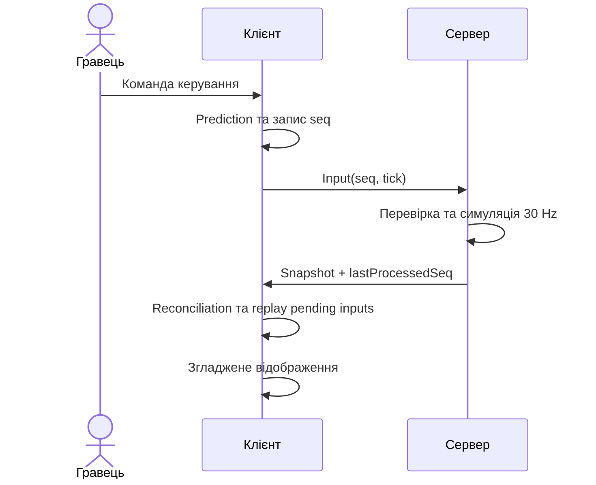
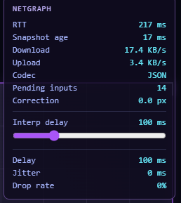
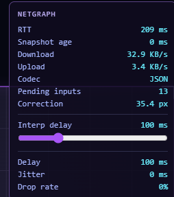

# Magic Arena — лабораторна робота №5

**Тема:** Мережа в реальному часі: авторитетний сервер, передбачення та бінарні протоколи  
**Проєкт:** Magic Arena — браузерна 2D-гра із зачарованим літаючим мечем  
**Технології:** JavaScript (ESM), Node.js, npm workspaces, WebSocket (`ws`), Vite, Canvas 2D, `ArrayBuffer`, `DataView`, Typed Arrays  
**Методичка:** [Lab 05 — Real-Time Networking](https://github.com/rmalkevy/Programming-Practice-Projects/blob/main/courses/javascript/lab-05-realtime-networking.md) · [Теорія та експерименти](https://github.com/rmalkevy/Programming-Practice-Projects/blob/main/courses/javascript/lab-05-realtime-networking.notes.md)

<!-- Для завершення демонстрації додати docs/lab05/multiplayer.gif та розкоментувати наступний рядок. -->
<!--  -->

## Мета та результат

Мета роботи — реалізувати синхронізацію багатокористувацької гри в реальному часі, забезпечити швидку реакцію на керування при мережевій затримці та дослідити ефективність бінарного формату повідомлень.

У Magic Arena сервер керує спільним станом арени, рухом мечів, снарядами, зіткненнями, пошкодженнями та відродженням. Клієнти передають команди керування й отримують snapshots. Для власного меча застосовано prediction і reconciliation, для чужих сутностей — інтерполяцію. Власні снаряди відображаються одразу після пострілу. Додано симулятор затримки, netgraph та два формати мережевих повідомлень: JSON і Binary.

Матеріали попередньої роботи: [ЛР №4 — Node.js, Streams і WebSocket](docs/lab04/README.md).

## Запуск

Команди виконуються з кореня репозиторію. Використовується Node.js 24.19.0 та npm.

```powershell
npm install
# Створити локальний .env, якщо його ще немає:
if (!(Test-Path server/.env)) { Copy-Item server/.env.example server/.env }
```

У першому терміналі:

```bash
npm run dev:server
```

У другому терміналі:

```bash
npm run dev:client
```

Відкрити `http://localhost:5173` у двох вікнах, ввести різні імена й зайти в одну кімнату. Vite проксує `/api` і `/ws` на Node-сервер за адресою `127.0.0.1:3000`.

Для запуску зібраного клієнта без Vite:

```bash
npm run build
node --env-file=server/.env server/src/index.js
```

Гра буде доступна за `http://127.0.0.1:3000`.

### Керування

| Клавіша | Дія |
|---|---|
| W | Прискорення меча |
| S | Гальмування |
| A / D | Обертання |
| Space | Звичайний постріл |
| H | Постріл із коригуванням траєкторії біля каменя |

Обидва типи снарядів мають однаковий базовий TTL — 1,5 с. Самонаведення обмежене радіусом 180 px і сектором ±45°; сила повороту плавно залежить від відстані та кута до цілі. Це зменшує різкі розвороти й розбіжності траєкторій у мережевій грі.

### Налаштування мережі

Приклад `server/.env` для демонстрації:

```dotenv
HOST=127.0.0.1
PORT=3000
LOG_DIR=server/logs
NET_CODEC=binary
NET_DELAY_MS=100
NET_JITTER_MS=30
NET_DROP_RATE=0.02
```

| Параметр | Призначення |
|---|---|
| `NET_CODEC` | `json` або `binary` для input і snapshot |
| `NET_DELAY_MS` | Базова штучна затримка в одному напрямку, мс |
| `NET_JITTER_MS` | Випадкове відхилення від базової затримки, мс |
| `NET_DROP_RATE` | Імовірність пропуску повідомлень, для яких дозволено втрату (0–1) |

Для локальної перевірки без штучних мережевих перешкод останні три параметри можна встановити в `0`. Після змін `.env` потрібно перезапустити сервер. Імітація втрат діє на рівні ігрових повідомлень, а не TCP-пакетів. Interp delay регулюється окремо в UI клієнта (50–250 мс, типово 100 мс).

## Структура проєкту

```text
MagicArena/
├── client/
│   └── src/
│       ├── main.js
│       └── network/
│           ├── connection.js      # WebSocket, reconnect, codec
│           ├── prediction.js      # передбачення і звірка меча
│           ├── interpolation.js   # буфер snapshots
│           ├── projectiles.js     # локальні снаряди та узгодження
│           ├── netgraph.js        # мережеві показники
│           └── math.js            # спільні математичні функції клієнта
├── server/
│   ├── src/
│   │   ├── game/
│   │   │   ├── Match.js          # серверний стан кімнати
│   │   │   ├── MatchManager.js   # керування матчами
│   │   │   └── tickLoop.js       # серверний крок 30 Hz
│   │   ├── network/latency.js    # delay, jitter, drop
│   │   ├── protocol.js           # перевірка повідомлень
│   │   └── ws.js                 # обмін input та snapshots
│   ├── scripts/
│   │   ├── codec-fixture.js
│   │   └── codec-benchmark.js
│   └── test/codec.test.js
├── shared/
│   ├── src/
│   │   ├── sim/                  # фізика, PRNG, світ, поведінки
│   │   ├── entities/             # класи сутностей
│   │   ├── protocol/             # формати повідомлень
│   │   └── codec/                # JSON та Binary
│   └── test/determinism.test.js
└── docs/lab05/                   # матеріали експериментів
```

## Виконання M1–M4

### M1 — Спільна симуляція та авторитетний сервер

Виділено workspace `@magicarena/shared`, доступний з Node.js і браузера. Спільний код містить `integrate()`, `World`, класи сутностей, генератор псевдовипадкових чисел `mulberry32`, протокол і кодеки. Симуляція не залежить від DOM, Canvas чи Node API; для випадкових ігрових подій використовується seeded PRNG.

Для кожної кімнати створюється `Match`. Сервер виконує симуляцію з частотою 30 Hz і фіксованим кроком `dt = 1/30`. Таймер працює через `setTimeout` із прив'язкою до абсолютного часу наступного тіку, що зменшує накопичення похибки планування. Обмежено кількість catch-up кроків. Статистика матчів, зокрема тривалість і jitter тіку, доступна через `GET /api/stats`.

Клієнт передає керування (`seq`, `tick`, `thrust`, `turn`, `brake`, `fire`, `homingFire`), а сервер перевіряє його і формує snapshot з `tick`, `lastProcessedSeq` та станом сутностей. Клієнт не може визначати власні координати чи пошкодження як істину для сервера.

На початковому етапі відображення власного меча залежало тільки від отриманих snapshots, тому при затримці керування реагувало із запізненням.

### M2 — Client-side prediction і reconciliation

Клієнт застосовує власну команду до локального стану меча одразу, а також зберігає її в черзі pending inputs. При отриманні snapshot підтверджені команди видаляються за `lastProcessedSeq`, стан встановлюється відповідно до сервера, після чого непідтверджені команди відтворюються повторно. Візуальна корекція згладжується приблизно за 100 мс для невеликих розбіжностей.



Це дозволяє реагувати на керування без очікування повного RTT. Сервер залишається джерелом остаточного стану.

### M3 — Інтерполяція та локальні снаряди

Клієнт накопичує snapshots і відображає чужі сутності між двома отриманими станами. Для позицій і кутів враховується циклічність арени та обертання. Нові й знищені сутності узгоджуються з серверними snapshots.

Власний снаряд створюється візуально відразу після натискання кнопки пострілу. Зіставлення з серверною кулею використовує ідентифікатор власника, sequence пострілу та його тип. `fireAck` підтверджує постріл; повторне передавання втрачених команд і дедуплікація зменшують ризик пропуску або повторного створення снаряда. Візуальна позиція власної кулі плавно коригується за серверними даними; зіткнення й пошкодження визначає сервер.

Під час розроблення виявлено ривки при переході від передбаченої кулі до серверної та розбіжності траєкторії самонавідних снарядів. Для зменшення цих ефектів реалізовано безперервний рух візуальної позиції з обмеженою корекцією, а глобальне самонаведення замінено локальним коригуванням біля цілі. Незначні візуальні розбіжності в умовах затримки можливі.

### M4 — Бінарний протокол

У `shared/src/codec/binary.js` реалізовано `encodeInput`, `decodeInput`, `encodeSnapshot`, `decodeSnapshot`. `ArrayBuffer` зберігає байти, `DataView` дозволяє читати та записувати різні типи за конкретними зміщеннями. Для всіх багатобайтових полів використано little-endian. Рядки кодуються в UTF-8 через `TextEncoder`/`TextDecoder`.

**Формат input (версія 1):**

| Зміщення | Поле | Тип |
|---:|---|---|
| 0 | Тип повідомлення: input = 1 | Uint8 |
| 1 | Версія | Uint8 |
| 2–5 | seq | Uint32 |
| 6–9 | tick | Uint32 |
| 10–17 | turn | Float64 |
| 18 | Прапорці керування | Uint8 |
| 19–22 | fireSeq (за наявності) | Uint32 |

Прапорці: біти 0–3 — thrust, brake, fire, homingFire; біт 4 — наявність fireSeq. Розмір input: 19 або 23 байти.

**Формат snapshot:** тип повідомлення (2), версія, tick, lastProcessedSeq, кількість сутностей і їхні поля за схемою. Тип сутності — Uint8, координати та швидкість — Float32, кут — Int16 із масштабом 1000 (крок 0,001 радіана). ID кодуються зі збереженням числового або рядкового типу. Масиви та UTF-8 рядки мають префікси довжини, а необов'язкові поля — ознаки наявності. Повна схема зафіксована в кодеку.

Вхідні повідомлення перевіряються на версію, тип, межі буфера, числові значення й відповідність протоколу. У браузері встановлено `socket.binaryType = 'arraybuffer'`. Службові повідомлення (join, joined, chat, ping/pong, fireAck) залишаються JSON. Формат ігрових повідомлень обирається через `NET_CODEC`.

## Netgraph

| Показник | Значення |
|---|---|
| RTT | Час проходження ping/pong туди й назад |
| Snapshot age | Час від отримання останнього snapshot |
| Download / Upload | Обсяг payload отриманих / відправлених повідомлень за секунду |
| Codec | Поточний формат input і snapshot |
| Pending inputs | Кількість непідтверджених команд |
| Correction | Величина корекції локальної позиції, px |
| Interp delay | Клієнтська затримка інтерполяції |
| Delay / Jitter / Drop rate | Поточні параметри симуляції мережі |

## Експеримент 1 — Детермінізм у Node.js та браузері

Для перевірки використано `runDeterministicScenario()` з однаковими параметрами: `seed = 1337`, `steps = 1000`, `dt = 1/30`. Кінцевий стан серіалізовано в JSON і обчислено SHA-256.

Під час першого порівняння хеші без округлення відрізнялися. Імовірна причина — незначні відмінності обчислень із плаваючою комою між середовищами. Після округлення дробових значень до восьми знаків після коми хеші збіглися. Округлення застосовано тільки для порівняння станів, а не для фізики гри.

Після зміни самонаведення й TTL перевірку повторено. **Фактичний спільний SHA-256 Node.js та браузера:**

```text
2c3473173bbe25250e49d567e01a55f7823bf3ea1bdff5a769f64a33362d729f
```

Node.js:

```powershell
node --input-type=module -e "import {runDeterministicScenario} from '@magicarena/shared'; import {createHash} from 'node:crypto'; const state=runDeterministicScenario({seed:1337,steps:1000,dt:1/30}); const json=JSON.stringify(state,(_,v)=>typeof v==='number'&&!Number.isInteger(v)?Number(v.toFixed(8)):v); console.log(createHash('sha256').update(json).digest('hex'));"
```

Браузер (DevTools → Console при запущеному Vite; імпорт через шлях до shared у локальному проєкті):

```javascript
{
  const { runDeterministicScenario } = await import(
    '/@fs/C:/Users/User/Desktop/MagicArena/shared/src/index.js'
  );
  const state = runDeterministicScenario({
    seed: 1337, steps: 1000, dt: 1 / 30,
  });
  const json = JSON.stringify(state, (_, v) =>
    typeof v === 'number' && !Number.isInteger(v)
      ? Number(v.toFixed(8)) : v
  );
  const hash = await crypto.subtle.digest(
    'SHA-256', new TextEncoder().encode(json)
  );
  console.log([...new Uint8Array(hash)]
    .map((b) => b.toString(16).padStart(2, '0')).join(''));
}
```

За іншого розташування репозиторію потрібно змінити абсолютний шлях імпорту. Результат підтверджує узгодженість кінцевого стану тестового сценарію при вибраній точності, а не побітову рівність усіх проміжних обчислень.

## Експеримент 2 — Навмисне порушення детермінізму

Умови: JSON, delay 100 мс, jitter 0 мс, drop 0%, interpolation delay 100 мс. У `shared/src/sim/sword.js` тимчасово додано випадкове зміщення X під час `integrate()`:

```javascript
const x = wrap(
  sword.x + vx * dt + (Math.random() - 0.5) * 20,
  world.width,
);
```

Клієнт і сервер незалежно генерували випадкові зміщення, тому передбачена позиція відрізнялася від авторитетної. Після експерименту випадкове зміщення видалено та відновлено `const x = wrap(sword.x + vx * dt, world.width);`.

**Фактичні показники netgraph (окремі моменти вимірювання):**

| Показник | Детермінована симуляція | З `Math.random()` |
|---|---:|---:|
| RTT | 217 мс | 209 мс |
| Snapshot age | 17 мс | 0 мс |
| Pending inputs | 14 | 13 |
| Correction | **0,0 px** | **35,4 px** |
| Download | 17,4 KB/s | 32,9 KB/s |
| Upload | 3,4 KB/s | 3,4 KB/s |

| До порушення | Після порушення |
|---|---|
|  |  |

**Висновок:** при нормальній фізиці передбачення в зафіксований момент збігалося із сервером. Після введення незалежної випадковості зафіксовано корекцію 35,4 px. Це разові показники, а не усереднена статистика. Відмінність download не є окремим виміром впливу випадковості на трафік, оскільки кількість і стан сутностей могли змінитися. Експеримент проведено до фінальної зміни механіки самонаведення.

## Експеримент 3 — JSON vs Binary

Команда:

```bash
node server/scripts/codec-benchmark.js
```

Для обох форматів використано однаковий тестовий стан арени: 4 гравці, 17 сутностей, 30 Hz. Пропускна здатність розрахована з фактичних розмірів повідомлень; час — середня тривалість encode + decode в циклі вимірювань після прогрівання.

| Кодек | Bytes/snapshot | Bytes/input | KiB/s down | KiB/s up | Snapshot encode + decode, µs | Input encode + decode, µs |
|---|---:|---:|---:|---:|---:|---:|
| JSON | 7163 | 129 | 209,85 | 3,78 | 233,38 | 5,98 |
| Binary (`DataView`) | 1937 | 23 | 56,75 | 0,67 | 906,69 | 9,06 |

- Snapshot зменшився на **72,96%**.
- Input зменшився на **82,17%**.
- Бінарний snapshot приблизно у 3,70 раза компактніший.

У цій реалізації Binary потребує більше часу на кодування та декодування через перевірки й обхід полів схеми в JavaScript. Вбудовані JSON-операції оптимізовані рушієм V8. Проте цикл обробки бінарного snapshot займає менше 1 мс у цьому benchmark. Вигода полягає в суттєвому зменшенні трафіку.

Це результати зафіксованого запуску benchmark етапу M4, до фінального рефакторингу. Обсяг трафіку наведено на одного клієнта за умови 30 input/s та 30 snapshot/s; транспортні заголовки й службові повідомлення не враховані. Це не замір реального трафіку під час живого матчу чотирьох гравців.

## Аналіз мережевої архітектури

**Затримка.** При snapshot-only підході власний меч реагував лише після обробки input сервером та отримання нового стану. Prediction забезпечує локальну реакцію відразу. За базової затримки 100 мс в обох напрямках зафіксовано RTT 209–217 мс. У момент нормального експерименту correction становив 0,0 px, хоча в черзі залишалися 14 команд. Отже, очікування підтвердження не зупиняє локальне керування. Окремого числового вимірювання часу реакції до prediction не збережено; порівняння до/після є якісним.

**Узгодженість.** Сервер є джерелом остаточного стану. Спільна симуляція, фіксований крок та seeded PRNG допомагають клієнту відтворювати рух. Якщо стани розійшлися, клієнт відкидає підтверджені команди, повторює решту й згладжує корекцію. Експеримент із `Math.random()` показав, чому незалежна випадковість у фізиці порушує передбачення. Додатковою причиною невеликих відмінностей є точність floating-point, що виявилося при порівнянні хешів без округлення.

**Захист від шахрайства.** Клієнт надсилає лише керування, а не остаточні координати, HP або результат зіткнень. Тому зміна локальних координат меча через DevTools не надає права телепортувати серверного гравця. Сервер перевіряє типи й діапазони input, послідовність команд та обмежує частоту повідомлень. Це не повна античит-система, але усуває довіру до клієнтського ігрового стану.

**Вибір interpolation delay.** Базове значення 100 мс відповідає приблизно трьом інтервалам snapshot при 30 Hz. Менше значення (50 мс) знижує візуальне відставання, але робить клієнт чутливішим до jitter та пропущених snapshots. Більше (150–250 мс) дає запас історії, проте показує віддалені сутності далі в минулому. 100 мс обрано як початковий компроміс між плавністю та актуальністю; регулятор дозволяє підібрати значення під умови з'єднання. Кількісних вимірів для кожного значення не проводилося.

**Lag compensation.** Через інтерполяцію гравець бачить віддалену сутність у минулому. Для точного врахування цього при пострілах можна зберігати історію серверного стану та перевіряти влучання на відповідний момент. Server-side rewind у цій роботі не реалізовано; це додаткове завдання, а не частина базових M1–M4.

## Перевірки

```bash
npm run lint
npm run build
node --test shared/test/*.test.js server/test/*.test.js
node server/scripts/codec-benchmark.js
```

Тести перевіряють незалежність shared від DOM, seeded PRNG, серіалізацію сутностей, детермінований сценарій, round-trip JSON/Binary, похибку квантування, пошкоджені та обрізані повідомлення, ненульовий byteOffset, а також обмеження серверного протоколу.

Окремі перевірки input і порожнього snapshot дали відповідно 23 і 16 байтів із правильним відновленням полів. Повторний запуск сценарію після зміни фізики підтвердив однакові хеші в обох середовищах. Підсумковий повторний запуск lint, build і всіх тестів після останнього рефакторингу слід виконати перед створенням тегу.

## Висновок

У лабораторній роботі реалізовано серверну симуляцію з частотою 30 Hz, клієнтське передбачення, звірку з сервером, інтерполяцію віддалених сутностей та передбачення власних снарядів. Експериментально показано вплив порушення детермінізму на корекцію стану. Бінарний кодек зменшив розмір snapshot на 72,96%, а input — на 82,17%. Отримана мережева архітектура є основою для наступних етапів розвитку Magic Arena.
