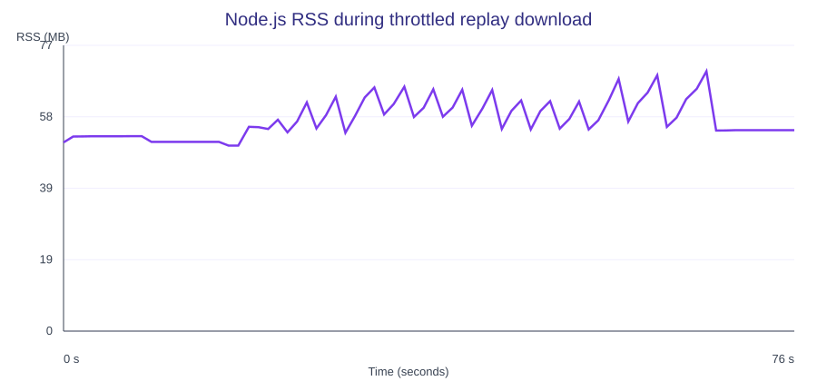

# Magic Arena — лабораторна робота №4

**Тема:** Node.js: `EventEmitter`, Streams і WebSocket-сервер  
**Проєкт:** Magic Arena — браузерна 2D-гра із зачарованим літаючим мечем  
**Технології:** JavaScript (ESM), Node.js, `node:http`, `EventEmitter`, Node Streams, `ws`, Vite, Canvas 2D, Web Audio API  
**Методичка:** [Lab 04 — Node.js, Streams and WebSockets](https://github.com/rmalkevy/Programming-Practice-Projects/blob/main/courses/javascript/lab-04-node-streams-websockets.md)

## Мета та результат

Мета лабораторної — ознайомитися з серверним середовищем Node.js, циклом подій libuv, подіями `EventEmitter`, потоками та backpressure, HTTP API і протоколом WebSocket.

У Magic Arena додано сервер, який обслуговує зібраний клієнт, створює кімнати, приймає підключення гравців і передає повідомлення чату в реальному часі. Події кімнат записуються у файли NDJSON; історія віддається потоком через HTTP. Реалізовано перевірку повідомлень, обмеження навантаження й коректне завершення сервера.

**Межі ЛР №4:** ігрова фізика, рух мечів і постріли поки виконуються локально в кожному браузері. Синхронізація ігрового стану через мережу запланована на ЛР №5.

## Запуск

Потрібні **Node.js 20.6+** (перевірено з Node.js **24.19.0**) і npm. Команди виконуються **з кореня репозиторію**.

1. Встановити залежності та створити локальну конфігурацію:

   ```powershell
   npm install
   Copy-Item server/.env.example server/.env
   ```

2. Відкрити два термінали. У першому запустити HTTP/WebSocket-сервер:

   ```bash
   npm run dev:server
   ```

3. У другому запустити клієнт Vite:

   ```bash
   npm run dev:client
   ```

4. Відкрити **http://localhost:5173**. Сценарій: **Loading → Lobby → Join → Game + Room Chat**. Для перевірки чату відкрити дві вкладки, ввести різні імена й обрати одну кімнату.

У dev-режимі Vite проксує `/api` і `/ws` на Node-сервер за адресою `http://127.0.0.1:3000`.

**Запуск зібраної версії без Vite:**

```bash
npm run build
node --env-file=server/.env server/src/index.js
```

Після цього гра доступна на **http://127.0.0.1:3000**. Додатковий пакет `dotenv` не потрібний: змінні завантажуються вбудованим прапорцем Node.js `--env-file`.

### Налаштування `.env`

```dotenv
HOST=127.0.0.1
PORT=3000
LOG_DIR=server/logs
ENABLE_SLOW_DEMO=0
RSS_PROFILE=0
```

`HOST`, `PORT` і `LOG_DIR` читаються та перевіряються в `server/src/config.js`. `ENABLE_SLOW_DEMO=1` активує експериментальний маршрут, а `RSS_PROFILE=1` — запис використання пам'яті. Файл `server/.env` та каталог `server/logs/` не додаються в Git.

## Структура проєкту

```text
MagicArena/
├── client/
│   ├── public/assets/          # спрайти, звуки, manifest, конфіг арени
│   ├── src/
│   │   ├── assets/              # асинхронне завантаження ресурсів
│   │   ├── lobby/               # інтерфейс вибору кімнати
│   │   ├── network/
│   │   │   ├── connection.js     # WebSocket, черга send, reconnect
│   │   │   ├── chat.js          # інтерфейс чату
│   │   │   └── chat.css
│   │   └── main.js              # запуск ігрового клієнта
│   └── vite.config.js           # proxy /api та /ws
├── server/
│   ├── src/
│   │   ├── index.js             # HTTP API, статичні файли, shutdown
│   │   ├── config.js            # конфігурація з оточення
│   │   ├── rooms.js             # Room extends EventEmitter, RoomManager
│   │   ├── protocol.js          # перевірка JSON-повідомлень
│   │   ├── ws.js                # WebSocket і heartbeat
│   │   └── log/
│   │       ├── matchlog.js      # Transform + pipeline -> NDJSON
│   │       ├── replay.js        # читання replay
│   │       └── rss.js           # профілювання RSS
│   ├── scripts/                 # генератор логу та графіка
│   ├── test/m4.test.js          # тести обмежень
│   └── .env.example
├── docs/lab04/rss.svg           # графік із фактичних вимірювань
├── package.json                # npm workspaces: client, server
└── README.md
```

## Виконання M1–M4

### M1 — HTTP-сервер і workspaces

Репозиторій поділено на `client/` і `server/`. Node HTTP-сервер віддає `client/dist` із відповідними MIME-типами та перевіряє шляхи, щоб не дозволити вихід за каталог збірки через `..`. У розробці Vite перенаправляє HTTP API й WebSocket-з'єднання на сервер. Параметри конфігурації беруться з оточення; для `SIGINT` і `SIGTERM` передбачене коректне завершення.

**HTTP API:**

| Метод і маршрут | Призначення |
|---|---|
| `GET /health` | Перевірка стану сервера; `{ "status": "ok" }` |
| `GET /api/rooms` | Список кімнат із кількістю гравців |
| `POST /api/rooms` | Створення кімнати з перевіркою JSON і лімітом тіла запиту |
| `GET /api/replays` | Список збережених NDJSON-записів |
| `GET /api/replays/:id` | Потокове завантаження історії |
| `GET /api/slow` | Демонстраційне блокування на ~300 мс; доступне лише з `ENABLE_SLOW_DEMO=1` |

Приклад створення кімнати:

```powershell
Invoke-RestMethod -Uri 'http://127.0.0.1:3000/api/rooms' `
  -Method Post -ContentType 'application/json' `
  -Body '{"name":"Crystal Hall","obstacleCount":2}'
```

### M2 — EventEmitter, WebSocket і чат

Клас `Room extends EventEmitter` містить `players: Map` і генерує події `join`, `leave`, `chat`, `empty`. `RoomManager` керує кімнатами та видаляє кімнату після виходу останнього гравця. HTTP API й WebSocket використовують один менеджер.

WebSocket працює через бібліотеку `ws` на маршруті `/ws`. Клієнт надсилає версійовані JSON-повідомлення:

```json
{"v":1,"type":"join","room":"arcane","name":"Mage1"}
```

```json
{"v":1,"type":"chat","text":"Hello!"}
```

Сервер відправляє `joined`, `roster`, `notice` та `chat`. Клієнтська обгортка підтримує чергу повідомлень під час з'єднання та автоматичне перепідключення з наростаючою паузою. У двох вкладках підтверджено спільний список гравців, чат, вихід учасника й перепідключення.

### M3 — потокові логи та replay

Події кімнат (`join`, `chat`, `leave`) записуються у `server/logs/<room>-<timestamp>.ndjson`: `PassThrough` у режимі об'єктів → `Transform` (об'єкт у JSON-рядок) → `createWriteStream`, з'єднані через `pipeline()`.

Формат: **одна подія — один рядок JSON**. Replay віддається через `createReadStream()` і `pipeline(readStream, res)`, без `readFile()` цілого файлу. Браузер може завантажувати NDJSON замість показу на сторінці — це очікувана поведінка для `application/x-ndjson`.

При `Ctrl+C` сервер закриває HTTP/WebSocket-з'єднання, завершує потоки й дописує логи перед завершенням.

### M4 — обмеження навантаження

Реалізовано:

- максимум **20 кімнат** на сервері та **4 гравці** в кімнаті;
- обов'язкове `join` протягом **5 с** після WebSocket-підключення;
- перевірку типу, версії й форми JSON та ліміт `maxPayload` **4096 байтів**;
- **Token Bucket**: місткість 15 токенів, поповнення 15 токенів/с; за перевищення — закриття сокета з кодом **4008**;
- `ping` раз на **15 с**, відключення після двох пропущених `pong`;
- політику повільного клієнта: при `bufferedAmount` понад **256 KiB** некритичні повідомлення пропускаються, для критичних можливе закриття;
- обробники `error` для сервера, WebSocket та файлових операцій.

**Фактична перевірка Token Bucket:** після надсилання 40 повідомлень поспіль отримано `Closed: 4008 Rate limit exceeded`.

## Дослідження Event Loop

Node.js виконує JavaScript-обробники в головному потоці, а libuv забезпечує асинхронну роботу з I/O. Основні фази циклу подій: **timers → pending callbacks → poll → check → close callbacks**. `setTimeout()` пов'язаний із таймерами, `setImmediate()` — із фазою `check`. Черги `process.nextTick` і мікрозадач Promise обробляються окремо від цих фаз; надмірна кількість синхронної роботи або `nextTick` може затримувати I/O.

Для демонстрації створено `GET /api/slow` з навмисним синхронним циклом на 300 мс. Паралельно було відправлено запит до `/health`.

| Вимірювання | Фактичний результат |
|---|---:|
| Блокування в `/api/slow` | **300 мс** |
| Час відповіді `/api/slow` | **414 мс** |
| Час відповіді `/health` | **417 мс** |

**Висновок:** навіть простий `/health` затримався майже на такий самий час, оскільки синхронний код іншого HTTP-обробника блокував головний потік. У реальному сервері тривалі CPU-операції не слід виконувати безпосередньо в обробнику запиту.

## Streams, backpressure та експеримент RSS

**Backpressure** виникає, коли джерело генерує дані швидше, ніж отримувач може їх приймати. Для Writable-потоку `write()` повертає `false`, коли його буфер досяг порога; тоді виробник має дочекатися `drain`. `pipeline()` автоматично узгоджує швидкість потоків і передає помилки, не вимагаючи завантажувати весь файл у RAM.

Для перевірки створено синтетичний лог обсягом **200 MiB**. Його завантажено з обмеженням швидкості близько **4 MiB/s**:

```powershell
node --env-file=server/.env server/scripts/create-synthetic-log.js
curl.exe --limit-rate 4M -o NUL "http://127.0.0.1:3000/api/replays/m4-synthetic-200mb"
```

**Фактичні результати:**

| Показник | Значення |
|---|---:|
| Розмір replay | **200 MiB** |
| Тривалість завантаження | **50 с** |
| Середня швидкість | **≈ 4 MiB/s** |
| Тривалість запису RSS | **≈ 76 с** |
| RSS під час експерименту | **приблизно 50–70 MiB** |



**Спостереження:** RSS коливався, але не зростав пропорційно переданим 200 MiB і після завершення передачі стабілізувався. Це узгоджується з потоковим читанням і контролем backpressure. Коливання RSS можливі через буфери, мережеве I/O, роботу V8 та збирача сміття.

Повторне вимірювання можна запустити з `RSS_PROFILE=1` у `server/.env`. Після завершення сервера останній файл `server/logs/rss-*.csv` перетворюється на графік командою:

```powershell
$csv = (Get-ChildItem .\server\logs\rss-*.csv |
  Sort-Object LastWriteTime -Descending |
  Select-Object -First 1).FullName
node server/scripts/rss-chart.js "$csv"
```

## `EventEmitter.error` та необроблені Promise

У `EventEmitter` подія **`error` без слухача** має особливу поведінку: Node.js викидає виняток і, якщо його ніхто не обробив, завершує процес з ненульовим кодом. Відтворення:

```bash
node -e "const {EventEmitter}=require('node:events'); new EventEmitter().emit('error',new Error('boom'))"
```

Без обробника типовий результат — `Unhandled 'error' event` та стек помилки. Варіант із виправленням:

```bash
node -e "const {EventEmitter}=require('node:events'); const e=new EventEmitter(); e.on('error',err=>console.error('Handled:',err.message)); e.emit('error',new Error('boom'))"
```

Очікуваний вивід: `Handled: boom` без аварійного завершення. Аналогічно, **необроблене відхилення Promise** у типовій конфігурації сучасного Node.js може завершити процес; його необхідно обробляти через `await` у `try/catch` або `.catch()`. Тому в сервері використовуються обробники `error` та контроль асинхронних операцій.

## ESM, CommonJS і Buffer

У проєкті використано **ES modules** (`"type": "module"`, `import`/`export`). CommonJS використовує `require()` і `module.exports`. На відміну від CommonJS, в ESM немає звичних `__dirname` та `__filename`; для визначення шляху використовується `import.meta.url` із `fileURLToPath()`. Вбудовані модулі імпортуються з префіксом `node:`.

`Buffer` представляє послідовність байтів, на відміну від довжини JavaScript-рядка у UTF-16 кодових одиницях. Сервер використовує `Buffer.concat()` для збирання обмеженого за розміром тіла POST-запиту.

## Перевірки

```bash
npm run lint
npm run build
node --test server/test/m4.test.js
```

**Фактичний результат тестів M4:** **4 пройдено, 0 помилок**. Перевірені ліміт кімнат, ліміт гравців, відхилення невідомого типу повідомлення та перевищення розміру повідомлення.

## Висновок

У ЛР №4 Magic Arena отримала серверну архітектуру з HTTP API, WebSocket-кімнатами та чатом. На практиці досліджено події Node.js, потоковий запис NDJSON, replay і захист від перевантаження. Вимірювання показали, що синхронний обробник затримує інші запити, а потокове завантаження великого файлу дозволяє утримувати використання оперативної пам'яті в обмеженому діапазоні. Отримана основа буде використана для мережевої синхронізації гри в ЛР №5.
