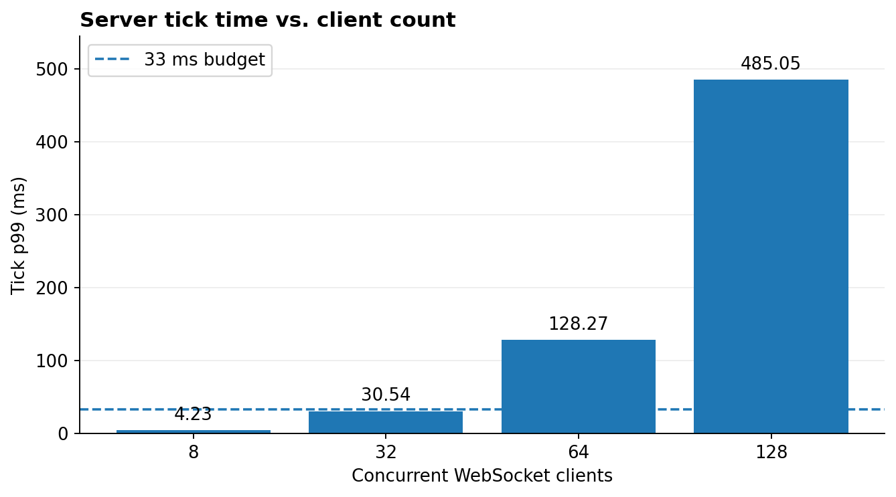
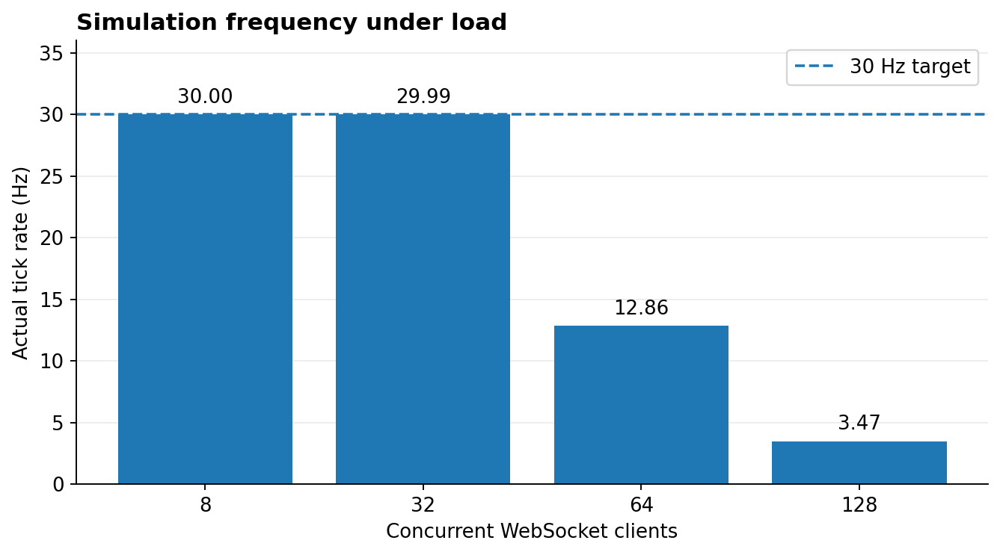
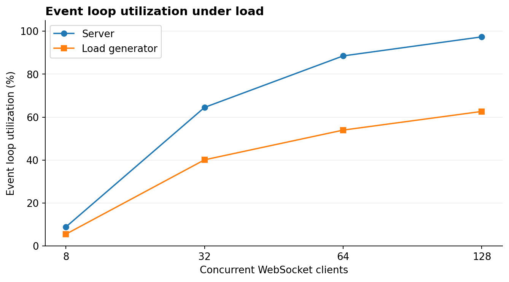

# M4.3 — Server load testing

## Setup

Windows 10, AMD Ryzen 5 4600H (12 logical CPUs), 15,741.32 MiB available physical RAM reported by OS, Node.js v24.19.0. Four scenarios with 8, 32, 64 and 128 headless WebSocket clients, 15 s warmup, 60 s requested measurement, seed 1337. Target: 30 Hz; tick p99 budget: 33 ms.

```sh
npm run test:load -- --clients=8,32,64,128 --warmup-ms=15000 --duration-ms=60000 --seed=1337
```

## Results

| Clients | Joined | Tick p99 (ms) | Tick rate (Hz) | Ticks over 33 ms | Server ELU | Peak RSS (MiB) | RX (KiB/s) | TX (MiB/s) | Budget |
|---:|---:|---:|---:|---:|---:|---:|---:|---:|---|
| 8 | 8/8 | 4.235 | 30.00 | 0 (0.00%) | 8.88% | 111.23 | 3.81 | 0.52 | Pass |
| 32 | 32/32 | 30.543 | 29.99 | 6 (0.33%) | 64.54% | 225.63 | 18.10 | 7.22 | Pass |
| 64 | 64/64 | 128.270 | 12.86 | 774 (100.00%) | 88.52% | 224.05 | 35.45 | 10.75 | Fail |
| 128 | 128/128 | 485.048 | 3.47 | 210 (100.00%) | 97.39% | 227.06 | 70.36 | 11.30 | Fail |







All four reports are marked valid. No disconnects, client errors, decoding errors, dropped messages or backpressure events were recorded. Validity does not imply passing the performance budget.

## Capacity and bottleneck

The largest passing tested count is **32**; the first failing tested count is **64**. Assuming monotonic degradation under the same workload, the threshold lies between these tested loads; counts 33–63 were not tested, so the exact maximum is unknown. At 32 clients, six of 1,800 ticks exceed 33 ms, but p99 remains within budget. At 64 and 128 clients, every measured tick exceeds the budget and the achieved tick rate drops to 12.86 and 3.47 Hz, respectively.

Server ELU rises from 8.88% to 97.39%, while peak RSS remains near 224–227 MiB at 32–128 clients. Output throughput approaches 11.30 MiB/s as tick rate falls. This supports server-side processing saturation as a likely bottleneck, not a demonstrated network or RAM limit. Earlier nine-player CPU profiling identified binary serialization and validation as hot paths; the specific bottleneck at high N was not separately profiled. Full-world snapshots sent to each client plausibly account for superlinear processing and payload growth.

## Limitations

One run per N, local loopback with server and generator sharing the same machine. Generator ELU reaches 62.66%; its CPU work and scheduling can influence the result. Actual client input rates are not identical: around 25.26, 30.02, 29.56 and 29.35 input messages per client per second (client inputsSent divided by server measurement duration, approximate because the client and server windows can differ). Network rates count application payload only, excluding TCP/IP/TLS/WebSocket framing. ELU is not total multicore CPU utilization. Results are specific to the tested machine and workload. The raw JSON files and summary are preserved unchanged.
